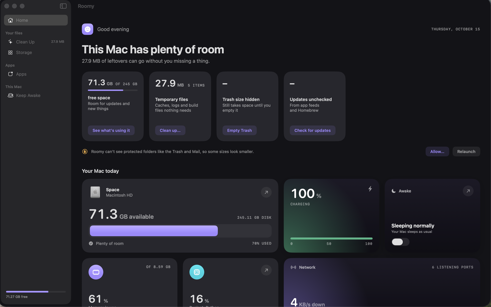

# Roomy

A native macOS app to see what's filling your disk, clean it up safely, keep your Mac awake (even with the lid closed), and keep an eye on it all from the menu bar.

Built with SwiftUI. It's free, open source and runs entirely on your Mac.



## Features

- **One click to free up space.** Roomy finds caches, logs, build files and installers on its own and tells you how much you can free safely. Press *Free Up* on Home, check the list, done.
- **Keep Awake.** Keep the Mac running for downloads, builds and remote sessions, with the lid closed too (this used to be a separate app, Simmer). Turn it on from the menu bar, Home or the Keep Awake page, for good or for 30 minutes to 8 hours. It turns itself off on low battery, when the Mac runs hot with the lid closed, and when you quit Roomy.
- **Every folder explains itself.** Badges like *Safe to remove*, *Rebuilds itself*, *Check first* and *Keep*, with a one-line note on what `.npm`, `.cache`, `Library` or `node_modules` actually are.
- **Undo.** Changed your mind after cleaning? Press Undo (⌘Z) and everything goes back where it was.
- **Cleanup queue, not a delete button.** Stage things from any screen. A bar floats over the app showing how much space you'll free and what your free space looks like afterwards. Review every item, then move the lot to the Trash.
- **Storage.** Scan your Home folder, the whole disk or any folder. A block map and a sorted list show where the space went. Click to go inside a folder. Large Files and Changes (compare two scans) live here too.
- **Quick Clean.** App caches, logs, Xcode DerivedData, Archives and Device Support, simulator caches, npm/pnpm/bun/pip caches, `node_modules`, `.next` and `.turbo` folders, installers and old files in Downloads.
- **Large files.** Every file over 50 MB, 100 MB, 500 MB or 1 GB.
- **Applications.** Updates from each app's own Sparkle feed and from Homebrew. Login items and launch agents with a switch to turn them off. Uninstall an app together with its support files, caches and preferences.
- **Menu bar.** Free space in the bar itself, and a cup while Keep Awake is on. Click it for the Keep Awake switch and timer, the drive, CPU, memory, battery and network, plus the busiest processes and listening ports.
- **Changes.** Each scan keeps the shape of your folders. Scan again later, compare the two, and see what grew, shrank, is new or is gone.
- **Light and dark.** Match the system, or pick one.
- **Private by design.** Scanning, sizing and matching happen on your Mac. No account, no sync, no analytics. The only network calls are update checks, and only when you press *Check for Updates*.

## Install

Requirements: macOS 14 (Sonoma) or later, and Xcode or the Xcode Command Line Tools (`xcode-select --install`).

```bash
git clone https://github.com/mdanassaif/roomy.git
cd roomy
./build.sh
```

This builds `Roomy.app`, signs it locally and copies it to `/Applications`. Open it from Launchpad or Spotlight.

To update later:

```bash
git pull && ./build.sh
```

### Recommended: Full Disk Access

Go to **System Settings → Privacy & Security → Full Disk Access** and add **Roomy**. It can then measure the Trash, Mail, Messages and other protected folders. Without it, Roomy still works, but some folders show up smaller and emptying the Trash goes through Finder.

### Optional: lid-closed mode

Keep Awake works with the lid open right away. To keep it going with the lid closed, press **Set Up…** on the Keep Awake page once and enter your password. Roomy installs `/etc/sudoers.d/roomy-awake`, which lets it run only `pmset -a disablesleep 0` and `pmset -a disablesleep 1` without asking again. When Keep Awake turns off, lid sleep goes back to how it was. To remove the rule: `sudo rm /etc/sudoers.d/roomy-awake`.

## Quick start

1. Open Roomy. It scans your files and finds what's safe to clean without being asked.
2. Press **Free Up** on Home.
3. Remove anything you want to keep, tick **Empty the Trash too** to get the space back straight away, then confirm.

To dig deeper, open **Storage** and press **Add** on anything you don't need.

Moving things to the Trash doesn't free space until the Trash is emptied.

## Safety

- Nothing is deleted without going through the review sheet, and moves to the Trash can be undone.
- By default, items go to the Trash, where you can put them back.
- System locations (`/System`, `/usr`, your Home, Library, Desktop, Documents and so on) and Apple apps are protected and can't be staged.

## Project layout

```
Sources/Roomy/
  Core.swift        scanner, file tree, volume info, safety rules, snapshots
  Services.swift    clean categories, apps & updates, startup items, system monitor
  AppModel.swift    app state, cleanup queue, trash
  Theme.swift       colors, cards, tiles, pills: the look
  Components.swift  shared views, treemap
  Guide.swift       plain-language explanations for known folders
  Awake.swift       Keep Awake: sleep locks, lid-closed mode, safety checks
  AwakeViews.swift  Keep Awake page, Home card, menu bar row
  Rooms.swift       Home (insights + "Your Mac today"), Storage, Clean Up, Large Files
  Rooms2.swift      Apps, Changes, review sheet, settings
  RoomyApp.swift    app entry, window, menu bar
build.sh            build + install script
```

## License

MIT
