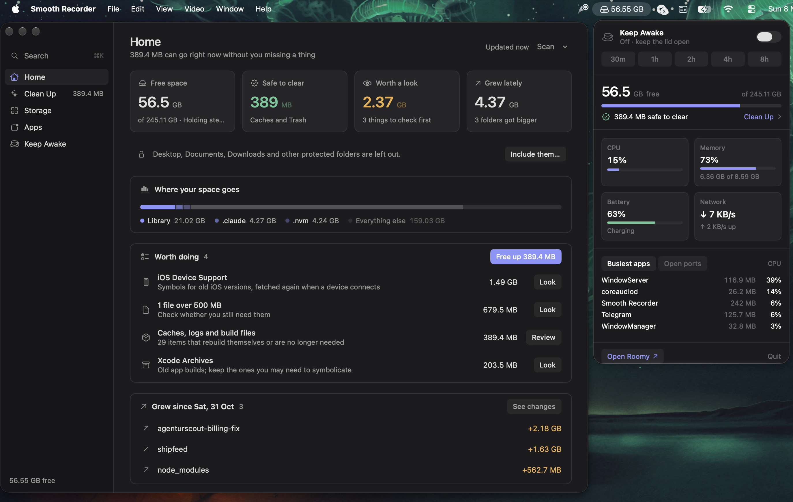

# Roomy

**See what's filling your Mac, clear it safely, and keep it awake when you need it.**

Roomy is a small, native macOS app built with SwiftUI. It tells you where your disk space went, explains in plain words what each thing is and whether it's safe to remove, and never deletes anything you haven't reviewed. It also keeps your Mac awake for long downloads and builds, with the lid closed too, and puts it all in your menu bar.

Free, open source, and it runs entirely on your Mac.



## What it does

### Know where your space went
- **Home at a glance.** Four numbers: free space, what's safe to clear, what's worth a look, and what grew lately. Click any of them to go straight there.
- **Storage.** Browse your folders sorted by size, see the biggest single files, group them by type (videos, archives, installers…), find duplicates by their contents, and compare two scans to see what grew.
- **Search.** Press ⌘K to find any folder or large file, or to jump to a page.
- **Forecast.** Roomy notes your free space a few times a day and tells you whether it's holding steady or running out.

### Clear it without worrying
- **Every item explains itself.** Each folder and file is marked **Safe**, **Rebuilds itself**, **Check first** or **Keep**, with a one-line reason: `node_modules` comes back with `npm install`, `.next` rebuilds on the next build, a `.git` pack is your project's history.
- **Keep means keep.** Things like git history, the tools you're using and macOS's own files have a lock instead of an Add button, so they can't be removed by accident.
- **Clean Up.** Roomy finds app caches, logs, Xcode build data and device support files, simulator and package-manager caches, project dependencies, and old installers in Downloads.
- **Review, then remove.** Add things from any page to a clean list. A bar shows how much you'll free. Check every item, then move them to the Trash. Changed your mind? Press ⌘Z.

### Keep your Mac awake
- Stay awake for 30 minutes to 8 hours, or until you turn it off. You can start it from the Keep Awake page or with one tap in the menu bar.
- Works with the lid closed after a one-time setup.
- It turns itself off when the timer ends, when the battery gets low, if the Mac runs hot with the lid closed, and when you quit Roomy.

### From the menu bar
Free space in the menu bar itself. Click it for Keep Awake, a shortcut to what's safe to clear, live CPU, memory, battery and network, the busiest apps and open ports.

### Apps
Check for app updates through each app's own update feed and Homebrew, turn login items and background helpers off, and uninstall an app together with its leftover files.

## Install

You need macOS 14 (Sonoma) or later, plus Xcode or the Command Line Tools (`xcode-select --install`).

```bash
git clone https://github.com/mdanassaif/roomy.git
cd roomy
./build.sh
```

`build.sh` builds Roomy, signs it, and installs it to `/Applications`. To update later, run `git pull && ./build.sh`.

If you have an Apple Development or Developer ID certificate, the script signs with it. That way macOS remembers Roomy's permissions across updates. Without one, it signs locally, and macOS may ask for permissions again after each build.

## Permissions

Roomy asks for one thing: **Full Disk Access**. It's Apple's single switch for apps that measure your disk. Without it, macOS guards Desktop, Documents, Downloads, Photos and other apps' data separately and asks about each one.

1. Open Roomy. A card on Home explains this and has an **Open System Settings** button.
2. Under **Privacy & Security → Full Disk Access**, switch **Roomy** on. If it isn't listed, click **+** and choose Roomy in Applications.
3. Come back to Roomy. It notices within a couple of seconds and starts scanning.

Prefer not to? Choose **Scan without it**. Roomy then leaves every protected folder out, so macOS never pops up a prompt. You can include them later.

**Already switched on, but Roomy still asks?** macOS may remember an older copy of the app. Select Roomy in that list, click **−**, then add it again with **+**.

### Lid-closed mode (optional)
Keep Awake works with the lid open right away. To keep it going with the lid closed, press **Set Up…** on the Keep Awake page and enter your password once. This adds `/etc/sudoers.d/roomy-awake`, which lets Roomy run exactly two commands without asking again: `pmset -a disablesleep 1` and `pmset -a disablesleep 0`. Nothing else. To undo it: `sudo rm /etc/sudoers.d/roomy-awake`.

## Safety

- Nothing is deleted without going through the review sheet.
- Items go to the Trash first, and the last clean can be undone with ⌘Z.
- System locations, your main folders (Home, Library, Desktop, Documents…) and Apple's apps are protected and can't be added.
- Roomy scans only when you press **Scan**. It never rescans or clears anything on its own.

## Privacy

Scanning, sizing and duplicate matching all happen on your Mac. There's no account, no sync and no analytics. The only network requests are update checks for your apps, and only when you ask for them.

## Shortcuts

| Keys | Action |
| --- | --- |
| ⌘K | Search |
| ⌘1 – ⌘5 | Home, Clean Up, Storage, Apps, Keep Awake |
| ⌘R | Scan again |
| ⌘[ | Up one folder in Storage |
| ⌘Z | Undo the last clean |

## Project layout

```
Sources/Roomy/
  RoomyApp.swift      app entry, window, sidebar, menu bar panel
  AppModel.swift      app state, scanning, clean list, Trash
  Core.swift          scanner, file tree, disk info, protected paths, Full Disk Access check
  Cache.swift         saved scan and Clean Up results, so Roomy opens instantly
  Guide.swift         plain-language advice: Safe, Rebuilds itself, Check first, Keep
  Services.swift      Clean Up categories, apps and updates, login items, system monitor
  Finder.swift        duplicates, file types, ⌘K search
  Insights.swift      free-space forecast and what grew lately
  Rooms.swift         Home, Storage, Clean Up, Large Files, Full Disk Access card
  Rooms2.swift        Apps, Changes, review sheet, Settings
  Awake.swift         Keep Awake: sleep locks, lid-closed mode, safety checks
  AwakeViews.swift    Keep Awake page
  Components.swift    shared rows, buttons and icons
  Theme.swift         colors and type
  DebugSnapshot.swift screenshots for checking the UI (ROOMY_SNAPSHOT)
build.sh              build, sign and install
makeicon.swift        draws the app icon
```

## License

MIT. See [LICENSE](LICENSE).
